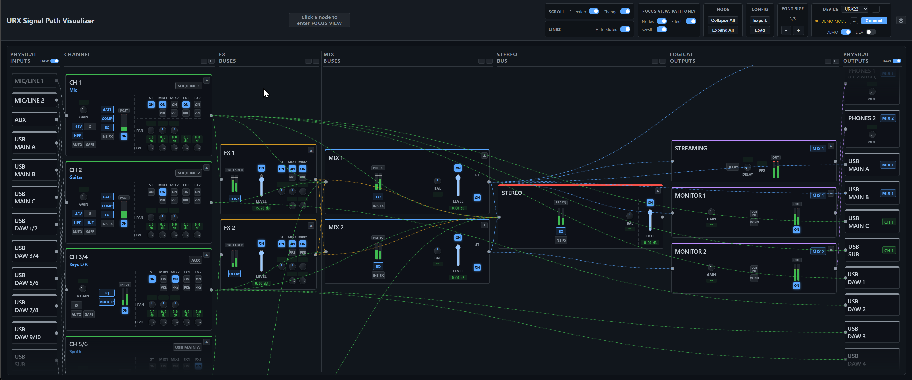

# URX Signal Path Visualizer

**v0.2.1 (beta)**

[English](#english) | [日本語](#日本語)

---

## English

A real-time signal-routing visualizer for the YAMAHA URX series (URX44V / URX44 / URX22).
It connects to Yamaha Device Center running on the same PC and shows the current routing, levels, and parameters live.

> **Note:** This tool is still in **beta**. Some features may not work as expected.

### Getting Started (Standalone App — Recommended)

Download the app for your OS from the [**Releases**](../../releases/latest) page:

- **Windows**: download the `.exe` installer and run it. If Windows SmartScreen shows a warning (the installer is not code-signed), click **More info** → **Run anyway**
- **macOS**: download the `.dmg`, open it, and drag the app into **Applications**. The app is **not code-signed**, so the first launch is blocked by Gatekeeper:
  - Right-click (Ctrl-click) the app → **Open** → **Open**
  - On recent macOS (Sequoia and later): try to open the app once, then go to **System Settings → Privacy & Security**, scroll down and click **Open Anyway**

The app runs entirely locally — the only network access is a version check against this repository's Releases page on launch.

**Auto-update**: the app checks this repository's Releases on every launch. On **Windows**, updates are downloaded in the background and you'll be asked to restart to apply. On **macOS**, the app shows a notification with a link to the download page (in-place update is not possible for unsigned apps).

### Uninstalling

- **Windows**: uninstall from **Settings → Apps → Installed apps → USPV → Uninstall** (or the Start-menu uninstaller). Your settings (window size/position) are removed automatically as part of the uninstall.
- **macOS**: quit the app and drag **USPV** from the Applications folder to the Trash. macOS has no uninstaller, so settings are left behind; to remove them too, delete `~/Library/Application Support/USPV` (in Finder: **Go → Go to Folder…** and paste the path).

### Getting Started (Browser)

The app is also a static web page that runs as-is — **no installation, no build, no Node.js required**.

1. Download this repository: click the green **Code** button → **Download ZIP** (or `git clone`)
2. Extract the ZIP anywhere
3. Double-click `index.html` (or drag it into your browser) — **Chrome** recommended (the only tested browser)

> **FYI:** Only 3 files are actually required to run the app in a browser: `index.html`, `css/styles.css`, and `dist/bundle.js` (keep the folder structure). Everything else in the repository is source code and documentation.

### Connecting to Your Device

1. Connect your URX to the PC and make sure **Yamaha Device Center** is running
2. Launch the app (or open `index.html` in a browser) — it connects to Device Center automatically
3. When connected, the device model is selected automatically, routing lines appear, and meters/knobs follow the actual device in real time

When Device Center is not running (or the device is disconnected), routing lines are hidden.

### Demo Mode

Want to try it without a device? Turn on the **Demo** toggle in the header (or open the page with `?demo` added to the URL). The app simulates device behavior: routing changes every few seconds and meters move.

### Basic Usage

| Action | What happens |
|---|---|
| Click a node | **FOCUS VIEW** — only the connected signal path is highlighted. Press `ESC` (or click the chip next to the title) to exit |
| `▲` on a node | Collapse the node to its title + a horizontal meter. `▼` restores it |
| **Collapse All / Expand All** | Collapse or restore every node at once |
| **Hide Muted** toggle | Show or hide muted (gray dashed) connection lines |
| Line legend (next to the title) | **FLOW** = moving dashes, an enabled signal path (color follows the source node); **MUTED** = still gray dashes, a path muted by a channel, send or level setting. Hover for details |
| Model selector | Switch between URX44V / URX44 / URX22 (selected automatically when a device is connected) |
| `−` / `＋` | Adjust the overall font size (5 steps) |
| **Export / Load** | Save the current settings (model, toggles, collapse states, ...) as a JSON file, or load one |

### License

MIT License — see [LICENSE](LICENSE).

This is an unofficial tool and is not affiliated with or endorsed by Yamaha Corporation.

---

## 日本語

YAMAHA URX シリーズ (URX44V / URX44 / URX22) のシグナルルーティングをリアルタイムに可視化するツールです。
同じ PC 上で動作する Yamaha Device Center と接続し、現在のルーティング・レベル・パラメータをライブ表示します。

> **注意:** 本ツールはまだ **β版** です。一部の機能が正常に動作しない場合があります。

### 使い方 (スタンドアロンアプリ — 推奨)

[**Releases**](../../releases/latest) ページからお使いの OS 用のアプリをダウンロードしてください:

- **Windows**: `.exe` インストーラをダウンロードして実行。Windows SmartScreen の警告が出た場合 (コード署名をしていないため) は **詳細情報** → **実行** をクリック
- **macOS**: `.dmg` をダウンロードして開き、アプリを **アプリケーション** フォルダにドラッグ。アプリは**コード署名されていない**ため、初回起動は Gatekeeper にブロックされます:
  - アプリを右クリック (Ctrl+クリック) → **開く** → **開く**
  - 新しめの macOS (Sequoia 以降): 一度アプリを開こうとした後、**システム設定 → プライバシーとセキュリティ** を下にスクロールして **このまま開く** をクリック

完全にローカルで動作します (外部への通信は、起動時にこのリポジトリの Releases を確認するバージョンチェックのみです)。

**自動アップデート**: アプリは起動のたびにこのリポジトリの Releases を確認します。**Windows** では新バージョンをバックグラウンドでダウンロードし、再起動して適用するか確認します。**macOS** では新バージョンの通知とダウンロードページへのリンクを表示します (署名なしアプリのためインプレース更新はできません)。

### アンインストール

- **Windows**: **設定 → アプリ → インストールされているアプリ → USPV → アンインストール** (またはスタートメニューのアンインストーラ) から削除します。設定 (ウィンドウのサイズ・位置) はアンインストール時に自動で削除されます。
- **macOS**: アプリを終了し、アプリケーションフォルダの **USPV** をゴミ箱にドラッグします。macOS にはアンインストーラの仕組みがないため設定が残ります。あわせて消す場合は `~/Library/Application Support/USPV` を削除してください (Finder で **移動 → フォルダへ移動…** にこのパスを貼り付け)。

### 使い方 (ブラウザ)

静的な Web ページとしてそのまま動かすこともできます。**インストール・ビルド・Node.js は一切不要**です。

1. このリポジトリをダウンロード: 緑色の **Code** ボタン → **Download ZIP** (または `git clone`)
2. ZIP を好きな場所に展開
3. `index.html` をダブルクリック (またはブラウザにドラッグ) — **Chrome** 推奨 (動作確認済みブラウザ)

> **参考:** ブラウザでの実行に本当に必要なのは `index.html`・`css/styles.css`・`dist/bundle.js` の3ファイルだけです (フォルダ構成は維持してください)。リポジトリ内のそれ以外はソースコードとドキュメントです。

### 実機との接続

1. URX を PC に接続し、**Yamaha Device Center** を起動しておく
2. アプリを起動する (またはブラウザで `index.html` を開く) と自動的に Device Center へ接続されます
3. 接続されるとモデルが自動選択され、結線が表示され、メーターやノブが実機にリアルタイムで追従します

Device Center が起動していない (または実機が切断されている) 間は、結線は表示されません。

### デモモード

実機がなくても試せます。ヘッダーの **Demo** トグルを ON にする (または URL に `?demo` を付けて開く) と、数秒ごとにルーティングが変化しメーターが動く実機シミュレーションが始まります。

### 基本操作

| 操作 | 動作 |
|---|---|
| ノードをクリック | **FOCUS VIEW** — 接続されている信号経路だけがハイライトされます。`ESC` (またはタイトル横のチップをクリック) で解除 |
| ノードの `▲` | ノードをタイトル + 横向きメーターだけに折りたたみ。`▼` で元に戻ります |
| **Collapse All / Expand All** | 全ノードを一括で折りたたみ / 展開 |
| **Hide Muted** トグル | ミュート中の結線 (灰色破線) の表示 / 非表示 |
| 結線の凡例 (タイトル横) | **FLOW** = 動く破線、有効な信号経路 (色は送信元ノードに対応)。**MUTED** = 静止した灰色破線、チャンネル・センド・レベル設定でミュートされた経路。ホバーで説明を表示 |
| モデルセレクタ | URX44V / URX44 / URX22 を切り替え (実機接続時は自動選択) |
| `−` / `＋` | 全体の文字サイズを調整 (5段階) |
| **Export / Load** | 現在の設定 (モデル・トグル・折りたたみ状態など) を JSON ファイルとして保存 / 読み込み |

### ライセンス

MIT License — [LICENSE](LICENSE) を参照してください。

本ツールは非公式のツールであり、ヤマハ株式会社とは一切関係ありません。
